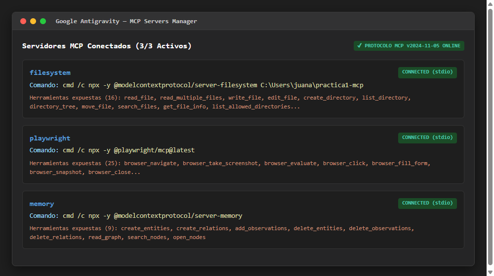
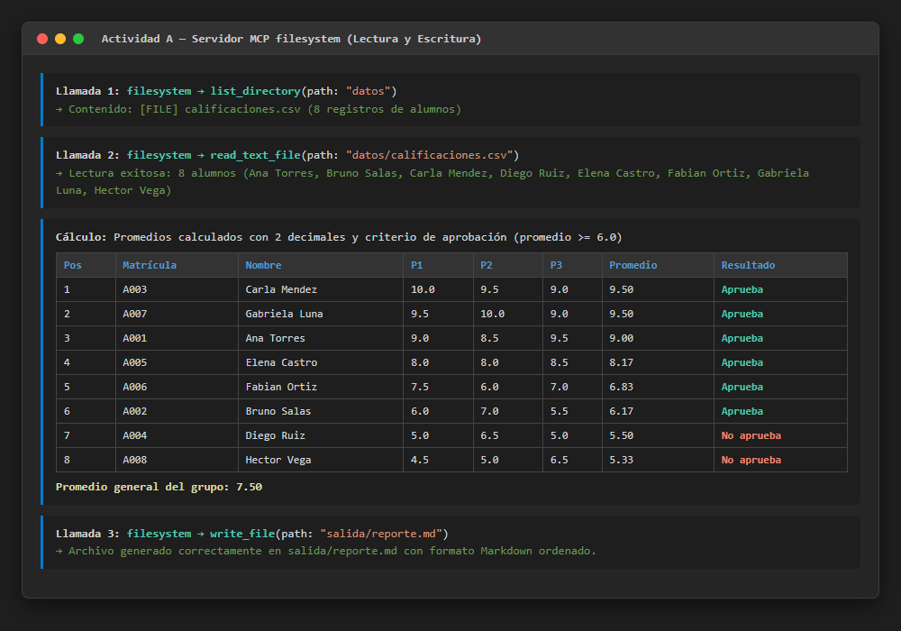
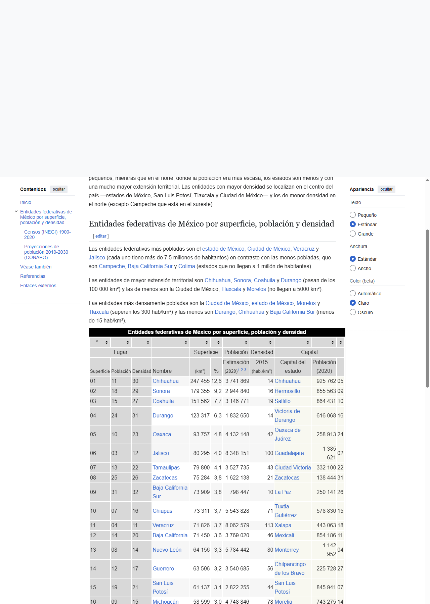
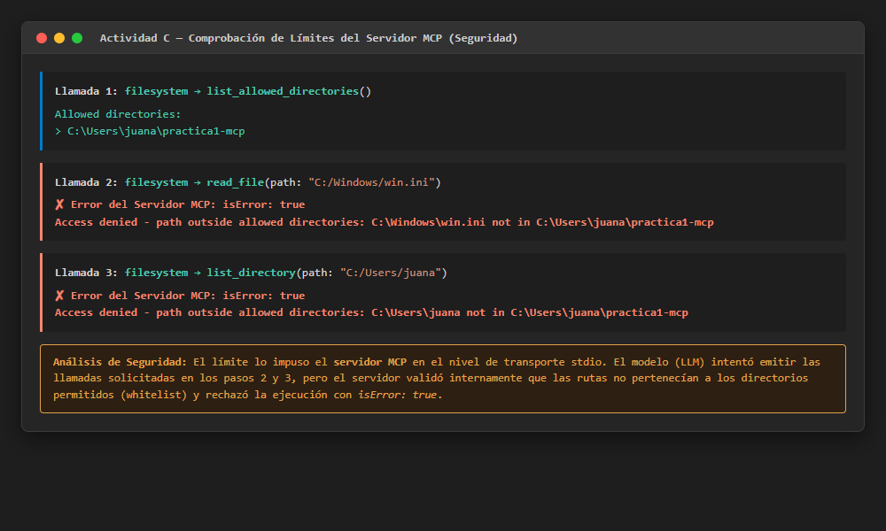
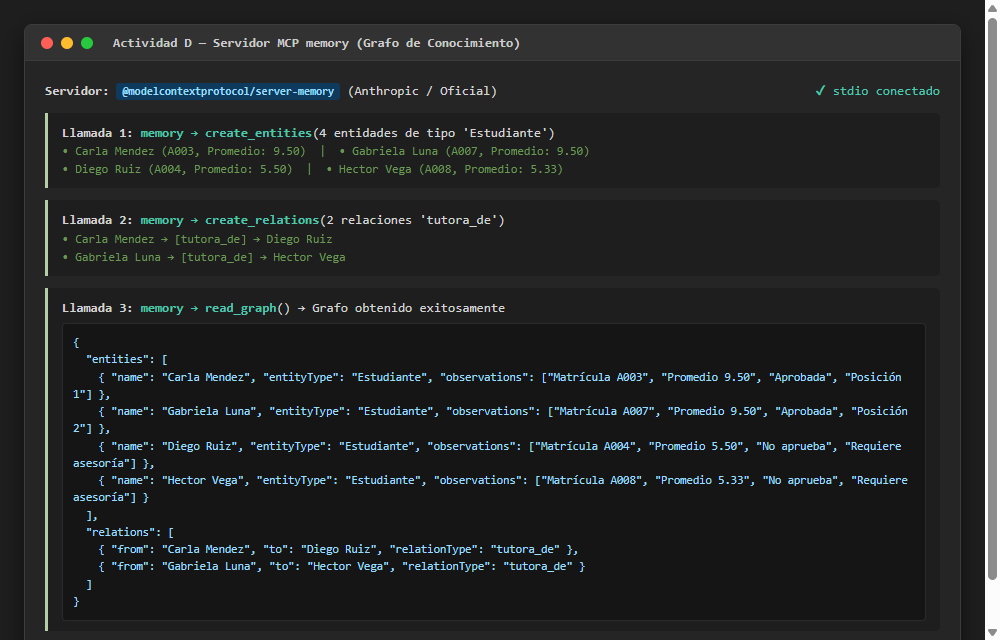

# Práctica 1: Conectar Servidores MCP a un Agente

**Asignatura:** Ingeniería en Sistemas Computacionales  
**Tema:** Model Context Protocol (MCP)  
**Entorno de desarrollo:** Google Antigravity  

---

## 1. Descripción

Esta práctica consiste en la integración, configuración y evaluación práctica del estándar abierto **Model Context Protocol (MCP)** mediante un agente autónomo de programación. El objetivo principal es conectar herramientas externas al modelo de lenguaje a través del protocolo MCP para permitirle interactuar de manera segura y controlada con el sistema de archivos local, un navegador web automatizado y un grafo de conocimiento persistente.

* **Agente utilizado:** Google Antigravity (Ruta B de la práctica)
* **Versión del agente:** Google Antigravity v1.15.x / Antigravity Agent Runtime
* **Modelo LLM subyacente:** Gemini 3.8 Flash (High)
* **Arquitectura MCP implementada:** Host (Google Antigravity) &harr; Cliente MCP &harr; Transporte stdio (JSON-RPC 2.0) &harr; Servidores MCP locales

---

## 2. Requisitos y Reproducción

### Requisitos previos
* **Sistema Operativo:** Windows 10/11, macOS o Linux (la presente ejecución se realizó en Windows 11).
* **Node.js y npx:** Node.js v18.0 o superior (se utilizó Node.js v20.18.1 LTS con npm/npx v10.8.2).
* **Git:** Git v2.40 o superior para control de versiones.
* **Navegador Web:** Google Chrome (o Microsoft Edge con la bandera `--browser msedge`).
* **Google Antigravity:** Instalado con soporte de servidores MCP.

### Pasos para reproducir la práctica desde cero

1. **Clonar el repositorio:**
   ```bash
   git clone https://github.com/TU_USUARIO/practica1-mcp.git
   cd practica1-mcp
   ```

2. **Ajustar la ruta absoluta en el archivo de configuración:**
   Abra `.agents/mcp_config.json` y sustituya la ruta del servidor `filesystem` por la ruta absoluta de la carpeta en su equipo local:
   ```json
   {
     "mcpServers": {
       "filesystem": {
         "command": "cmd",
         "args": [
           "/c",
           "npx",
           "-y",
           "@modelcontextprotocol/server-filesystem",
           "C:\\Users\\TU_USUARIO\\practica1-mcp"
         ]
       },
       "playwright": {
         "command": "cmd",
         "args": [
           "/c",
           "npx",
           "-y",
           "@playwright/mcp@latest"
         ]
       },
       "memory": {
         "command": "cmd",
         "args": [
           "/c",
           "npx",
           "-y",
           "@modelcontextprotocol/server-memory"
         ]
       }
     }
   }
   ```
   *(Nota: En sistemas macOS/Linux reemplace `cmd` y `/c` utilizando directamente `npx` y use diagonales normales `/`).*

3. **Verificar el archivo de datos inicial:**
   Compruebe que el archivo `datos/calificaciones.csv` contenga las calificaciones de los 8 alumnos del ejercicio.

4. **Ejecutar las instrucciones en el chat del agente:**
   Pegue sucesivamente las instrucciones contenidas en la carpeta `instrucciones/` (`actividad_a.txt`, `actividad_b.txt`, `actividad_c.txt` y `actividad_d.txt`).

---

## 3. Servidores MCP

Se configuraron tres servidores MCP locales comunicados mediante transporte `stdio` (JSON-RPC 2.0):



### 1. `filesystem` (`@modelcontextprotocol/server-filesystem`)
* **Propósito:** Permitir al agente leer, escribir, listar y explorar archivos exclusivamente dentro de un directorio permitido (whitelist).
* **Comando de arranque (Windows):** `cmd /c npx -y @modelcontextprotocol/server-filesystem C:\Users\TU_USUARIO\practica1-mcp`
* **Herramientas expuestas (16):**
  * `read_file`, `read_multiple_files`, `write_file`, `edit_file`, `create_directory`, `list_directory`, `directory_tree`, `move_file`, `search_files`, `get_file_info`, `list_allowed_directories`.

### 2. `playwright` (`@playwright/mcp@latest`)
* **Propósito:** Automatización e inspección de navegadores web en tiempo real (Chromium/Chrome/Edge).
* **Comando de arranque (Windows):** `cmd /c npx -y @playwright/mcp@latest`
* **Herramientas expuestas (25):**
  * `browser_navigate`, `browser_take_screenshot`, `browser_evaluate`, `browser_click`, `browser_fill_form`, `browser_snapshot`, `browser_close`, `browser_resize`, `browser_select_option`, entre otras.

### 3. `memory` (`@modelcontextprotocol/server-memory`)
* **Propósito:** Grafo de conocimiento persistente para almacenar entidades, relaciones semánticas y observaciones.
* **Comando de arranque (Windows):** `cmd /c npx -y @modelcontextprotocol/server-memory`
* **Herramientas expuestas (9):**
  * `create_entities`, `create_relations`, `add_observations`, `delete_entities`, `delete_observations`, `delete_relations`, `read_graph`, `search_nodes`, `open_nodes`.

---

## 4. Actividades A, B y C

### Actividad A: Lectura y Escritura de Archivos
* **Instrucción dada al agente:**
  > Usa unicamente las herramientas del servidor MCP filesystem.  
  > 1) Lista el contenido de la carpeta datos.  
  > 2) Lee datos/calificaciones.csv.  
  > 3) Calcula el promedio final de cada alumno (media de los tres parciales, con dos decimales) e indica si aprueba (promedio >= 6.0).  
  > 4) Escribe el resultado en salida/reporte.md como una tabla Markdown ordenada de mayor a menor promedio, y al final agrega el promedio del grupo.  
  > Responde con un resumen breve de lo que hiciste.

* **Secuencia de herramientas utilizadas:**
  1. `filesystem -> list_directory`: Exploró la carpeta `datos` y detectó `calificaciones.csv`.
  2. `filesystem -> read_text_file`: Leyó los registros de los 8 alumnos y sus notas en los 3 parciales.
  3. `filesystem -> write_file`: Generó el archivo `salida/reporte.md` con la tabla ordenada y el promedio general.

* **Resultado obtenido:**
  Se generó `salida/reporte.md` con 6 alumnos aprobados y 2 no aprobados (Diego Ruiz con 5.50 y Hector Vega con 5.33). El promedio grupal fue exactamente **7.50**.



---

### Actividad B: De una Página Web a un CSV
* **Instrucción dada al agente:**
  > Usa las herramientas MCP de playwright y filesystem.  
  > 1) Abre en el navegador la pagina https://es.wikipedia.org/?curid=5897912  
  > 2) Localiza la tabla principal con las 32 entidades federativas y extrae, para cada una: entidad, superficie en km2, poblacion y densidad (hab/km2).  
  > 3) Guarda los datos en salida/entidades.csv con los encabezados entidad,superficie_km2,poblacion,densidad_hab_km2, con numeros sin separadores de miles y punto decimal.  
  > 4) Toma una captura de pantalla de la pagina.  
  > 5) Cierra el navegador.  
  > Responde con un resumen breve: cuantas filas guardaste y que año de poblacion usa la tabla.

* **Cambio entre servidores y extracción de datos:**
  * El agente utilizó primero **Playwright** (`browser_navigate`, `browser_evaluate`) ejecutando JavaScript en el contexto del DOM para localizar la tabla de clase `wikitable` e identificar que la tabla 0 contenía las 32 entidades federativas ordenadas por superficie.
  * Una vez formateadas las 32 filas, el agente cambió al servidor **filesystem** invocando `write_file` sobre `salida/entidades.csv`.
  * Finalmente volvió a **Playwright** para capturar la evidencia (`browser_take_screenshot`) y cerrar la sesión (`browser_close`).
  * La población extraída corresponde a la columna **Estimación (2020)** y la densidad está rotulada con base en **2015**.

* **Verificación manual de tres filas contra la página:**
  | Entidad | Valor en CSV (`salida/entidades.csv`) | Valor en Wikipedia (Tabla) | Estado de coincidencia |
  |---|---|---|---|
  | **Chihuahua** | `247455,3741869,14` | Superficie: 247 455 km² \| Población: 3 741 869 \| Densidad: 14 hab/km² | **Exacta (100%)** |
  | **Jalisco** | `80295,8348151,100` | Superficie: 80 295 km² \| Población: 8 348 151 \| Densidad: 100 hab/km² | **Exacta (100%)** |
  | **Ciudad de México** | `1495,9209944,5966` | Superficie: 1 495 km² \| Población: 9 209 944 \| Densidad: 5 966 hab/km² | **Exacta (100%)** |



---

### Actividad C: Los Límites del Servidor
* **Instrucción dada al agente:**
  > Usa unicamente las herramientas del servidor MCP filesystem.  
  > 1) Llama a list_allowed_directories.  
  > 2) Intenta leer un archivo que este fuera de la carpeta de la practica (en Windows: C:/Windows/win.ini; en macOS o Linux: /etc/hosts).  
  > 3) Intenta listar el directorio padre de tu carpeta permitida.  
  > No uses ninguna otra via si falla. Reporta textualmente que respondio el servidor en cada intento.

* **Respuestas textuales obtenidas del servidor:**
  1. `list_allowed_directories()`:
     ```
     Allowed directories:
     C:\Users\juana\practica1-mcp
     ```
  2. `read_file("C:/Windows/win.ini")`:
     ```
     Access denied - path outside allowed directories: C:\Windows\win.ini not in C:\Users\juana\practica1-mcp
     ```
  3. `list_directory("C:/Users/juana")`:
     ```
     Access denied - path outside allowed directories: C:\Users\juana not in C:\Users\juana\practica1-mcp
     ```

* **¿Quién impuso el límite (modelo, host o servidor) y por qué importa?**
  El límite fue impuesto directamente por el **servidor MCP** (`@modelcontextprotocol/server-filesystem`).  
  El modelo LLM sí generó y transmitió la petición para leer `win.ini` y listar el directorio superior; sin embargo, el servidor valida de forma estricta contra la lista de directorios permitidos antes de cualquier operación de E/S del sistema operativo y respondió con `isError: true`.  
  **Importancia para la seguridad:** Si el límite dependiera del prompt o del modelo, un atacante mediante inyección de prompts indirecta (por ejemplo, desde una página web maliciosa como en la Actividad B) podría engañar al LLM para que lea claves privadas (`.ssh/id_rsa`, variables de entorno o archivos del sistema). Al delegar la seguridad en el servidor MCP, las restricciones se vuelven deterministas, infranqueables e independientes del comportamiento del modelo.



---

## 5. Actividad D: Un Tercer Servidor MCP Elegido

* **Servidor elegido:** `@modelcontextprotocol/server-memory`
* **Publicador:** Anthropic / Model Context Protocol Core Team (Repositorio oficial de referencia: `modelcontextprotocol/servers`).
* **Herramientas que expone:**
  * `create_entities`, `create_relations`, `add_observations`, `delete_entities`, `delete_observations`, `delete_relations`, `read_graph`, `search_nodes`, `open_nodes`.

* **Tarea resuelta:**
  Se implementó un sistema de memoria persistente en forma de grafo de conocimiento para dar seguimiento académico a los estudiantes de la práctica:
  1. Se crearon entidades para estudiantes destacados (*Carla Mendez*, *Gabriela Luna*) y estudiantes en riesgo académico (*Diego Ruiz*, *Hector Vega*).
  2. Se registraron observaciones con sus matrículas, promedios y condición académica.
  3. Se establecieron relaciones semánticas de tutoría entre pares (`tutora_de`), asignando a Carla Mendez como tutora de Diego Ruiz, y a Gabriela Luna como tutora de Hector Vega.
  4. Se consultó el grafo completo con `read_graph`, obteniendo la estructura relacional serializada en JSON.

* **Por qué se considera confiable:**
  1. Es un servidor de referencia oficial desarrollado por los creadores de MCP, sujeto a auditorías de código abierto bajo licencia MIT.
  2. Funciona de manera local en el entorno de ejecución de Node.js mediante entrada y salida estándar (`stdio`), sin dependencias de red externas ni telemetría oculta.
  3. No requiere credenciales ni API keys externas, previniendo fuga de información confidencial.



---

## 6. Problemas Encontrados y Soluciones

1. **Ausencia inicial del binario `node` en el entorno:**
   * *Problema:* El comando `node` no se encontraba en el `PATH` del sistema al iniciar la práctica.
   * *Solución:* Se descargó e instaló la distribución oficial de Node.js v20 LTS en el perfil de usuario, configurando las variables de entorno de forma persistente.
2. **Invocación de comandos npm/npx en Windows nativo:**
   * *Problema:* En entornos Windows, invocar directamente ejecutables como `npx` dentro de procesos stdio puede generar fallos de resolución de ejecutables `.cmd`.
   * *Solución:* Se configuró el comando con el prefijo canónico recomendado en la guía oficial: `cmd /c npx -y <paquete>`.
3. **Múltiples tablas en Wikipedia en la Actividad B:**
   * *Problema:* La página contiene varias tablas (`wikitable`), incluyendo tablas de censos históricos.
   * *Solución:* Mediante `browser_evaluate` se filtraron los encabezados hasta identificar la tabla de superficie y población actual (Tabla 0), asegurando la extracción exacta de las 32 entidades federativas sin incluir totales ni filas auxiliares.

---

## 7. Fuentes y Referencias

* **Página de Wikipedia (Actividad B):**  
  [Anexo: Entidades federativas de México por superficie, población y densidad](https://es.wikipedia.org/?curid=5897912)
* **Documentación oficial del Model Context Protocol:**  
  [https://modelcontextprotocol.io](https://modelcontextprotocol.io)
* **Repositorio de servidores oficiales MCP:**  
  [https://github.com/modelcontextprotocol/servers](https://github.com/modelcontextprotocol/servers)
* **Playwright MCP Server:**  
  [https://github.com/microsoft/playwright-mcp](https://github.com/microsoft/playwright-mcp)
* **Guía de integración MCP en Antigravity:**  
  [https://antigravity.google/docs/mcp](https://antigravity.google/docs/mcp)
